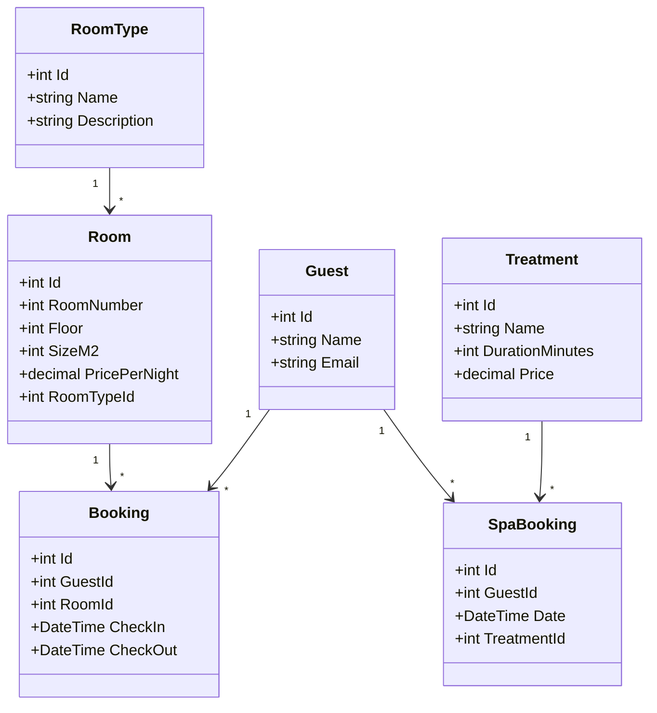

# Hotel Grandioso — Inlämning 1

**Namn:** Daniella

## Så kör du projektet

1. Forka repot på GitHub och klona din fork
2. Öppna `HotelGrandioso.slnx` i Visual Studio (eller öppna mappen i VS Code)
3. Tryck **F5** för att starta

Via terminalen:

```bash
dotnet run --project HotelGrandioso
```

## Databas

- Databas: SQLite
- Migrationer: [hur du skapar och kör dem]

## UML-klassdiagram



## GDPR

På grund av GDPR är det viktigt att vi hanterar gästers information på ett säkert sätt. Vi samlar endast in nödvändig information.

Därför samlar vi inte in någon överflödig och onödig information om gästers religion, hårfärg eller längd då detta bryter mot GDPR principer. Vi samlar endast in gästens namn och e-postadress.
Vi följer principerna för om dataminimering och sparar endast uppgifter nödvändiga för att hantera bokningar.

| Fält | Sparas? | Motivering
|------|---------|----------------|
| Name | Ja | Behövs för att veta vem bokningen berör. |
| Email | Ja | Behövs för bokningsbekräftelse och kommunikation. |
| Religion | Nej | Särskild kategori av personuppgifter med extra strikta krav och ingen syfte i en bokning. |
| Hår färg | Nej | Inte relevant för bokning. |
| Längd | Nej | Inte relevant för bokning. |

## Designmönster

Beskriv det designmönster du använt (till exempel Repository), vad det gör och varför du valde det.

>

## Tekniker

- C# / .NET 10
- Entity Framework Core
